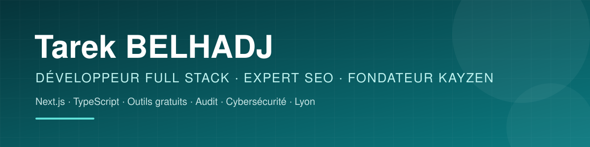

<p align="center">
  
</p>

<p align="center">
  <a href="https://www.kayzen-lyon.com"></a>
  <a href="https://www.kayzen-lyon.com/portfolio"></a>
  <a href="https://www.linkedin.com/in/tarek-belhadj-lyon/"></a>
  <a href="mailto:contact@kayzen-lyon.fr"></a>
</p>

## 👋 Bonjour, je suis Tarek

Développeur web full stack et spécialiste SEO, je fonde **KAYZEN LYON**, agence web et studio produit à Lyon. Je conçois des sites rapides et bien référencés pour les PME, et je développe des outils gratuits autour de trois sujets : **la visibilité** (SEO, GEO, moteurs de réponse IA), **la conformité** (RGPD, accessibilité RGAA) et **la sécurité** (mots de passe, secrets, tests d'intrusion).

Je code depuis 2007, d'abord en freelance (création de sites, référencement, maintenance), et j'ai consolidé cette pratique par plusieurs formations en développement, en SEO et en gestion de projet digital. Mon passé de commercial dans la high-tech me sert surtout à une chose : comprendre ce dont un client a vraiment besoin avant d'écrire la première ligne de code.

```
🎯 Des outils web utiles, rapides et conformes — et une bonne partie d'entre eux gratuits pour tous.
```

---

## 🎬 Nouveau : KAYZEN Flux, offert à la communauté

J'ai le plaisir de mettre à disposition de tous, gratuitement et en open source (licence MIT), **[KAYZEN Flux](https://github.com/kayzen-lyon/kayzenflux)** : un logiciel complet et soigné pour télécharger et convertir vos vidéos et vos musiques, qui fait ce que les convertisseurs en ligne ne font pas : **tout le travail se passe sur votre ordinateur**. Vous collez un lien, l'application récupère le fichier et le convertit chez vous. Aucun média ne transite par un serveur de KAYZEN.

C'est un projet dont je suis particulièrement fier, parce qu'il réunit dans une seule application tout ce qu'on attend d'un outil sérieux :

- **Des formats propres** : MP3, M4A, Opus, FLAC et MP4 jusqu'en 4K, avec titre, artiste, pochette et chapitres ;
- **Rien à payer, rien à subir** : pas de version payante, pas de publicité, pas de pistage, pas de compte à créer ;
- **Une vraie médiathèque** : bibliothèque et lecteur hors connexion, playlists, abonnements à des chaînes et à des podcasts ;
- **De l'intelligence locale** : transcription horodatée et résumé, calculés sur votre machine (whisper.cpp, Ollama) ;
- **Une extension** pour Chrome, Edge et Firefox : lecture sans publicité, saut des segments sponsorisés (SponsorBlock) et envoi d'un lien à l'application en un clic ;
- **Partout** : Windows, macOS et Linux.

Sous le capot, le même niveau d'exigence : un moteur local qui n'écoute que sur votre machine, des binaires embarqués vérifiés par empreinte à chaque lancement, yt-dlp lancé sans interpréteur de commandes, et un cœur de logique couvert par des tests. Le code est public précisément pour cela : vous n'avez pas à me croire sur parole, vous pouvez vérifier.

Pourquoi le donner ? Parce qu'un outil aussi courant ne devrait obliger personne à confier ses fichiers à un inconnu ni à traverser un mur de publicités. KAYZEN Flux est prévu pour les contenus que vous avez le droit de copier ; les contenus protégés par DRM ne sont pas pris en charge. Retours, rapports de bogue, traductions et contributions sont les bienvenus.

🌐 [Page de présentation et téléchargement](https://flux.kayzen-lyon.com) • 📖 [L'étude de cas](https://www.kayzen-lyon.com/portfolio/kayzen-flux) • ⭐ [Le dépôt sur GitHub](https://github.com/kayzen-lyon/kayzenflux)

---

## 🇪🇺 eu-web-compliance, offert à la communauté

Je mets à disposition de tous, gratuitement et en open source (licence MIT), **[eu-web-compliance](https://github.com/kayzen-lyon/eu-web-compliance)** : un skill pour les agents IA de développement (Claude Code, Codex, GitHub Copilot, Cursor…). Avec lui, l'agent qui crée ou modifie un site applique dès la première ligne de code les obligations européennes qui le concernent :

- **Accessibilité** : European Accessibility Act, EN 301 549, WCAG 2.2 AA, RGAA ;
- **Données personnelles** : RGPD, cookies et traceurs ;
- **Intelligence artificielle** : AI Act, obligations de transparence ;
- **Sécurité** : guides de l'ANSSI, OWASP ;
- **Droit de la consommation** : mentions légales, vente en ligne, bouton de rétractation, et les documents juridiques qui vont avec.

Chaque règle cite sa source officielle, et quatre vérificateurs testent le résultat dans un vrai navigateur. Le skill ne remplace ni un audit ni un juriste, et il le dit : chaque rapport liste les points à faire vérifier par une personne.

**Depuis la version 1.1** : le skill s'utilise désormais aussi sans agent IA. Les mêmes règles et les mêmes vérificateurs sont accessibles en ligne de commande (`npx github:kayzen-lyon/eu-web-compliance audit dist`), dans GitHub Actions (`uses: kayzen-lyon/eu-web-compliance@v1`) et comme serveur MCP. S'y ajoutent trois fiches pour WordPress, PrestaShop et Shopify, et une veille hebdomadaire des sources officielles citées.

Pourquoi le donner ? Parce que de plus en plus de sites sont écrits par des agents IA, et qu'un site inaccessible ou qui piste ses visiteurs sans leur accord pénalise tout le monde. Retours, corrections et contributions sont les bienvenus.

🌐 [Page de présentation et mode d’emploi](https://eu-web-compliance.kayzen-lyon.com) • 👉 [Installer le skill](https://github.com/kayzen-lyon/eu-web-compliance#installation) • ⭐ [Le dépôt sur GitHub](https://github.com/kayzen-lyon/eu-web-compliance)

---

## 🎓 Formations

| Formation | Organisme |
|---|---|
| **Bachelor Chef de projet digital** | Digital Campus, Lyon |
| **Licence Développeur Web Full Stack** | Lyon / Villeurbanne |
| **Expert SEO — Responsable marketing digital & publicité** | Oreegami, Lyon |
| **Intégrateur WordPress** | Simplon, Lyon |
| **Support technique — certification Microsoft MCTS** | M2I, Lyon |

---

## 🎁 Gratuit pour la communauté

Des outils utilisables sans payer, souvent sans inscription :

| Outil | Ce qu'il fait | Lien |
|---|---|---|
| 🎬 **KAYZEN Flux** | Logiciel libre (MIT) pour télécharger et convertir vidéos et musiques en MP3, M4A, Opus, FLAC ou MP4, entièrement sur votre ordinateur — Windows, macOS, Linux, extension Chrome, Edge et Firefox | 👉 [flux.kayzen-lyon.com](https://flux.kayzen-lyon.com) |
| 🇪🇺 **eu-web-compliance** | Skill open source pour agents IA : accessibilité, RGPD, AI Act, sécurité ANSSI et droit de la consommation appliqués dès la création du site ; aussi en ligne de commande, GitHub Action et serveur MCP | 👉 [github.com/kayzen-lyon/eu-web-compliance](https://github.com/kayzen-lyon/eu-web-compliance) |
| 🔐 **Sésame** | Gestionnaire de mots de passe chiffré de bout en bout, 2FA et passkeys — web, extensions Chrome, Edge et Firefox, Android, Windows | 👉 [sesame.kayzen-lyon.com](https://sesame.kayzen-lyon.com) |
| ⚡ **Sésame Éclair** | Partage d'un secret par lien chiffré qui s'autodétruit après lecture | 👉 [eclair.kayzen-lyon.com](https://eclair.kayzen-lyon.com) |
| 📄 **DocuSûr** | 75 outils pour PDF, images et documents, traités entièrement dans le navigateur : vos fichiers ne quittent pas votre appareil | 👉 [docusur.kayzen-lyon.com](https://docusur.kayzen-lyon.com) |
| 🌦️ **Météo Climat France** | Prévisions heure par heure, cartes interactives et météo agricole pour chaque commune de France | 👉 [meteo-climat-france.vercel.app](https://meteo-climat-france.vercel.app) |
| 🔎 **Nexus SEO** | Audit SEO, GEO et AEO gratuit, sans carte bancaire, et plus de 50 outils sur une même plateforme | 👉 [nexus.kayzen-lyon.com](https://nexus.kayzen-lyon.com) |
| 🍪 **Konsent** | Audit RGPD gratuit : ce que votre site dépose avant le consentement | 👉 [konsent.kayzen-lyon.com](https://konsent.kayzen-lyon.com) |
| 🔮 **L'Archiste** | Numérologie, thème natal et arts divinatoires, sans inscription | 👉 [archiste.vercel.app](https://archiste.vercel.app) |

### 📂 Code publié sur GitHub

| Dépôt | Description |
|---|---|
| [**kayzenflux**](https://github.com/kayzen-lyon/kayzenflux) | KAYZEN Flux : téléchargeur et convertisseur multimédia local, sans publicité ni pistage — Electron, React, TypeScript, yt-dlp, FFmpeg — [voir le site](https://flux.kayzen-lyon.com) |
| [**eu-web-compliance**](https://github.com/kayzen-lyon/eu-web-compliance) | Skill pour agents IA : sites conformes aux obligations européennes (EAA, RGAA, RGPD, AI Act, ANSSI, consommation) |
| [**kayzen-turf-ai**](https://github.com/kayzen-lyon/kayzen-turf-ai) | PronoTurf (Kayzen Turf) : pronostics hippiques par modèle multi-agents, marché par opérateur, chronos, poids et forme — Next.js, Postgres — [voir le site](https://kayzen-turf-ai.vercel.app) |

Le [design system KAYZEN](https://www.kayzen-lyon.com/design-system) est également consultable publiquement.

---

## 🛡️ Audit & conformité

| Outil | Ce qu'il mesure | Lien |
|---|---|---|
| **Nexus SEO** | SEO technique, GEO, AEO, LLMO | 👉 [nexus.kayzen-lyon.com](https://nexus.kayzen-lyon.com) |
| **CITEIA** | Lisibilité du site par les robots IA et données structurées | 👉 [synaptik.kayzen-lyon.com](https://synaptik.kayzen-lyon.com) |
| **Konsent** | Cookies et traceurs, comportement réel du code face au consentement | 👉 [konsent.kayzen-lyon.com](https://konsent.kayzen-lyon.com) |
| **eu-web-compliance** | Accessibilité, RGPD, AI Act, sécurité et droit de la consommation, appliqués par l'agent IA qui code le site | 👉 [Repo](https://github.com/kayzen-lyon/eu-web-compliance) |
| **Konforme** | Accessibilité RGAA et WCAG | 👉 [konforme.kayzen-lyon.com](https://konforme.kayzen-lyon.com) |

## 🔒 Cybersécurité

| Projet | Description | Statut |
|---|---|---|
| **Sentinel** | Tests d'intrusion menés par des agents IA : failles démontrées et correctifs proposés en pull requests | 👉 [sentinel.kayzen-lyon.com](https://sentinel.kayzen-lyon.com) |
| **Kayzen Security** | Plateforme unifiée pour TPE/PME : filtrage DNS anti-phishing, puis inventaire, antivirus, EDR | 🧪 Pilote gratuit — [kayzen-security.vercel.app](https://kayzen-security.vercel.app) |
| **VPN KAYZEN** | VPN gratuit, complément de Kayzen Security | 🛠️ En préparation |
| **Sésame / Sésame Éclair** | Mots de passe et secrets chiffrés de bout en bout | ✅ En ligne |

## 🧪 IA, data & applications

| Projet | Description | Lien |
|---|---|---|
| **Météo Climat France** | Cartes MapLibre, prévisions et volet agronomique | 👉 [Site](https://meteo-climat-france.vercel.app) |
| **PronoTurf** | Modèle multi-agents Plackett-Luce, logique de pari fondée sur la CLV | 👉 [Site](https://kayzen-turf-ai.vercel.app) |
| **PronoFoot** | Analyse prédictive et gestion de bankroll | 👉 [Site](https://pronofoot-pearl.vercel.app) |
| **Studio** | Retouche photo RAW non destructive | 👉 [Site](https://studio-ai-mauve.vercel.app) |
| **Tableo** | Commandes et paiements par QR code (React, Supabase) | 👉 [Site](https://tableo-sepia.vercel.app) |
| **FoncierMCP** | Serveur MCP pour agents IA | 👉 [Site](https://fonciermcp.vercel.app) |

---

## 🌐 Sites réalisés

Une sélection — le portfolio complet (41 réalisations) est sur **[kayzen-lyon.com/portfolio](https://www.kayzen-lyon.com/portfolio)**.

| Bâtiment & artisanat | Restauration & commerce | Culture, santé & services |
|---|---|---|
| [Muller Toiture](https://mullertoiture.vercel.app) — estimateur de toiture | [Au P'tit Zinc](https://www.auptitzinc.fr) | [Acte 2 Théâtre](https://acte2theatre.vercel.app) — billetterie |
| [BTP EA Rénovation](https://www.btp-ea-renovation.com) | [Chez Mounier](https://chez-mounier-liard.vercel.app) — bouchon lyonnais | [Art Scénic](https://velvet-stage-arts-main.vercel.app) |
| [SER & BAT](https://www.seretbat.fr) | [Grand Café du Commerce](https://grandcafeducommerce.vercel.app) | [Congrès JOD 2026](https://www.congres-jod.org) — inscriptions |
| [AH Élec Rénov](https://ah-elec-renov.vercel.app) — tunnel de devis | [La Raffinerie](https://la-raffinerie-lyon.vercel.app) | [Nutriéa](https://naturo-nutri.vercel.app) — 797 pages |
| [Damien Mugnier](https://damien-mugnier-main.vercel.app) — carrelage | [Maison Victoire](https://maison-victoire.vercel.app) — bilingue | [Hans Leutenegger SA](https://hl-web-master.vercel.app) — portail emploi multilingue |
| [Net Rénovation](https://www.net-renovation.fr) | [Boucherie de l'Avenue](https://www.boucherie-avenue.fr) | [France Évasions](https://www.france-evasions.fr) — location d'autocars |
| [LM Espace Vert](https://www.lm-espace-vert.fr) | [Restaurant Zigana](https://zigana.vercel.app) | [Philippe Reynaud](https://www.philippe-reynaud.fr) — photographe |
| [Le Galant](https://legalant.vercel.app) — coutellerie | [Halles de Lyon Paul Bocuse](https://halles-paul-bocuse-master.vercel.app) | [Atelier JUMP](https://atelier-jump-pr.vercel.app) — textile |

---

## 🧰 Stack technique

<p>
  
</p>

| Domaine | Technologies |
|---|---|
| **Front** | Next.js 15, React, Vite, TypeScript, Tailwind CSS, Framer Motion |
| **Back & données** | Node.js, Python, Supabase, Postgres (Neon), Drizzle ORM, Payload CMS, Sanity |
| **Sécurité** | WebCrypto, WebAssembly, chiffrement côté client |
| **IA** | Agents et systèmes multi-agents, serveurs MCP (Model Context Protocol), Claude Code |
| **SEO** | SEO technique et éditorial, GEO / AEO / LLMO, données structurées, netlinking, SXO |
| **Infra** | Vercel, monorepos Turborepo / pnpm, GitHub Actions |

## 📊 Activité GitHub

<p>
  
  
</p>

---

<p align="center">
  📫 Un site, un audit SEO / RGPD / accessibilité, ou envie de contribuer à un outil ?
  <a href="mailto:contact@kayzen-lyon.fr">contact@kayzen-lyon.fr</a>
</p>
