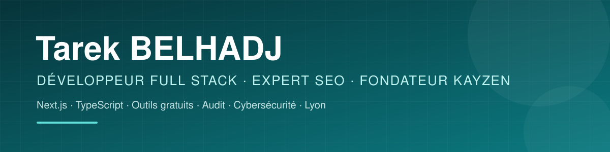

<p align="center">
  
</p>

<p align="center">
  <a href="https://www.kayzen-lyon.com"></a>
  <a href="https://www.kayzen-lyon.com/portfolio"></a>
  <a href="https://www.linkedin.com/in/tarek-belhadj-lyon/"></a>
  <a href="mailto:contact@kayzen-lyon.fr"></a>
</p>

## 👋 Bonjour, je suis Tarek

Développeur web full stack et spécialiste SEO, je fonde **KAYZEN LYON**, agence web et studio produit à Lyon. Je conçois des sites rapides et bien référencés pour les PME, et je développe des outils gratuits autour de trois sujets : **la visibilité** (SEO, GEO, moteurs de réponse IA), **la conformité** (RGPD, accessibilité RGAA) et **la sécurité** (mots de passe, secrets, tests d'intrusion).

Je code depuis 2007, d'abord en freelance (création de sites, référencement, maintenance), et j'ai consolidé cette pratique par plusieurs formations en développement, en SEO et en gestion de projet digital. Mon passé de commercial dans la high-tech me sert surtout à une chose : comprendre ce dont un client a vraiment besoin avant d'écrire la première ligne de code.

```
🎯 Des outils web utiles, rapides et conformes — et une bonne partie d'entre eux gratuits pour tous.
```

---

## 🎓 Formations

| Formation | Organisme |
|---|---|
| **Bachelor Chef de projet digital** | Digital Campus, Lyon |
| **Licence Développeur Web Full Stack** | Lyon / Villeurbanne |
| **Expert SEO — Responsable marketing digital & publicité** | Oreegami, Lyon |
| **Intégrateur WordPress** | Simplon, Lyon |
| **Support technique — certification Microsoft MCTS** | M2I, Lyon |

---

## 🎁 Gratuit pour la communauté

Des outils utilisables sans payer, souvent sans inscription :

| Outil | Ce qu'il fait | Lien |
|---|---|---|
| 🔐 **Sésame** | Gestionnaire de mots de passe chiffré de bout en bout, 2FA et passkeys — web, extension, Android, Windows | 👉 [sesame.kayzen-lyon.com](https://sesame.kayzen-lyon.com) |
| ⚡ **Sésame Éclair** | Partage d'un secret par lien chiffré qui s'autodétruit après lecture | 👉 [eclair.kayzen-lyon.com](https://eclair.kayzen-lyon.com) |
| 📄 **DocuSûr** | 31 outils PDF traités entièrement dans le navigateur : vos fichiers ne quittent pas votre poste | 👉 [docusur.kayzen-lyon.com](https://docusur.kayzen-lyon.com) |
| 🌦️ **Météo Climat France** | Prévisions heure par heure, cartes interactives et météo agricole pour chaque commune de France | 👉 [meteo-climat-france.vercel.app](https://meteo-climat-france.vercel.app) |
| 🔎 **Nexus SEO** | Audit SEO, GEO et AEO — gratuit pour commencer | 👉 [nexus.kayzen-lyon.com](https://nexus.kayzen-lyon.com) |
| 🍪 **Konsent** | Audit RGPD : ce que votre site dépose avant le consentement | 👉 [konsent.kayzen-lyon.com](https://konsent.kayzen-lyon.com) |
| 🔮 **L'Archiste** | Numérologie, thème natal et arts divinatoires, sans inscription | 👉 [archiste.vercel.app](https://archiste.vercel.app) |

### 📂 Code publié sur GitHub

| Dépôt | Description |
|---|---|
| [**konforme**](https://github.com/skyymar69-rgb/konforme) | Accessibilité web RGAA & WCAG automatisée par IA |
| [**nexus-seo**](https://github.com/skyymar69-rgb/nexus-seo) | Plateforme SEO IA : GEO, AEO, LLMO, audit technique |
| [**kayzen-turf-ai**](https://github.com/skyymar69-rgb/kayzen-turf-ai) | Pronostics hippiques : modélisation multi-agents Plackett-Luce |
| [**fonciermcp**](https://github.com/skyymar69-rgb/fonciermcp) | Serveur MCP autour des données foncières |
| [**naturo-nutri**](https://github.com/skyymar69-rgb/naturo-nutri) | Portail de 797 pages en naturopathie, avec quiz de tempérament |
| [**tableo**](https://github.com/skyymar69-rgb/tableo) | SaaS de commande et de paiement par QR code pour la restauration |

Le [design system KAYZEN](https://www.kayzen-lyon.com/design-system) est également consultable publiquement.

---

## 🛡️ Audit & conformité

| Outil | Ce qu'il mesure | Lien |
|---|---|---|
| **Nexus SEO** | SEO technique, GEO, AEO, LLMO | 👉 [nexus.kayzen-lyon.com](https://nexus.kayzen-lyon.com) |
| **CITEIA** | Lisibilité du site par les robots IA et données structurées | 👉 [synaptik.kayzen-lyon.com](https://synaptik.kayzen-lyon.com) |
| **Konsent** | Cookies et traceurs, comportement réel du code face au consentement | 👉 [konsent.kayzen-lyon.com](https://konsent.kayzen-lyon.com) |
| **Konforme** | Accessibilité RGAA et WCAG | 👉 [konforme.kayzen-lyon.com](https://konforme.kayzen-lyon.com) • ✏️ [Repo](https://github.com/skyymar69-rgb/konforme) |

## 🔒 Cybersécurité

| Projet | Description | Statut |
|---|---|---|
| **Sentinel** | Tests d'intrusion menés par des agents IA : failles démontrées et correctifs proposés en pull requests | 👉 [sentinel.kayzen-lyon.com](https://sentinel.kayzen-lyon.com) |
| **Kayzen Security** | Plateforme unifiée pour TPE/PME : filtrage DNS anti-phishing, puis inventaire, antivirus, EDR | 🧪 Pilote gratuit — [kayzen-security.vercel.app](https://kayzen-security.vercel.app) |
| **VPN KAYZEN** | VPN gratuit, complément de Kayzen Security | 🛠️ En préparation |
| **Sésame / Sésame Éclair** | Mots de passe et secrets chiffrés de bout en bout | ✅ En ligne |

## 🧪 IA, data & applications

| Projet | Description | Lien |
|---|---|---|
| **Météo Climat France** | Cartes MapLibre, prévisions et volet agronomique | 👉 [Site](https://meteo-climat-france.vercel.app) |
| **PronoTurf** | Modèle multi-agents Plackett-Luce, logique de pari fondée sur la CLV | 👉 [Site](https://kayzen-turf-ai.vercel.app) • ✏️ [Repo](https://github.com/skyymar69-rgb/kayzen-turf-ai) |
| **PronoFoot** | Analyse prédictive et gestion de bankroll | 👉 [Site](https://pronofoot-pearl.vercel.app) |
| **Studio** | Retouche photo RAW non destructive | 👉 [Site](https://studio-ai-mauve.vercel.app) |
| **Tableo** | Commandes et paiements par QR code (React, Supabase) | 👉 [Site](https://tableo-sepia.vercel.app) • ✏️ [Repo](https://github.com/skyymar69-rgb/tableo) |
| **FoncierMCP** | Serveur MCP pour agents IA | 👉 [Site](https://fonciermcp.vercel.app) • ✏️ [Repo](https://github.com/skyymar69-rgb/fonciermcp) |

---

## 🌐 Sites réalisés

Une sélection — le portfolio complet (40 réalisations) est sur **[kayzen-lyon.com/portfolio](https://www.kayzen-lyon.com/portfolio)**.

| Bâtiment & artisanat | Restauration & commerce | Culture, santé & services |
|---|---|---|
| [Muller Toiture](https://mullertoiture.vercel.app) — estimateur de toiture | [Au P'tit Zinc](https://www.auptitzinc.fr) | [Acte 2 Théâtre](https://acte2theatre.vercel.app) — billetterie |
| [BTP EA Rénovation](https://www.btp-ea-renovation.com) | [Chez Mounier](https://chez-mounier-liard.vercel.app) — bouchon lyonnais | [Art Scénic](https://velvet-stage-arts-main.vercel.app) |
| [SER & BAT](https://www.seretbat.fr) | [Grand Café du Commerce](https://grandcafeducommerce.vercel.app) | [Congrès JOD 2026](https://www.congres-jod.org) — inscriptions |
| [AH Élec Rénov](https://ah-elec-renov.vercel.app) — tunnel de devis | [La Raffinerie](https://la-raffinerie-lyon.vercel.app) | [Nutriéa](https://naturo-nutri.vercel.app) — 797 pages |
| [Damien Mugnier](https://damien-mugnier-main.vercel.app) — carrelage | [Maison Victoire](https://maison-victoire.vercel.app) — bilingue | [Hans Leutenegger SA](https://hl-web-master.vercel.app) — portail emploi multilingue |
| [Net Rénovation](https://www.net-renovation.fr) | [Boucherie de l'Avenue](https://www.boucherie-avenue.fr) | [France Évasions](https://www.france-evasions.fr) — location d'autocars |
| [LM Espace Vert](https://www.lm-espace-vert.fr) | [Restaurant Zigana](https://zigana.vercel.app) | [Philippe Reynaud](https://www.philippe-reynaud.fr) — photographe |
| [Le Galant](https://legalant.vercel.app) — coutellerie | [Halles de Lyon Paul Bocuse](https://halles-paul-bocuse-master.vercel.app) | [Atelier JUMP](https://atelier-jump-pr.vercel.app) — textile |

---

## 🧰 Stack technique

<p>
  
</p>

| Domaine | Technologies |
|---|---|
| **Front** | Next.js 15, React, Vite, TypeScript, Tailwind CSS, Framer Motion |
| **Back & données** | Node.js, Python, Supabase, Postgres (Neon), Drizzle ORM, Payload CMS, Sanity |
| **Sécurité** | WebCrypto, WebAssembly, chiffrement côté client |
| **IA** | Agents et systèmes multi-agents, serveurs MCP (Model Context Protocol), Claude Code |
| **SEO** | SEO technique et éditorial, GEO / AEO / LLMO, données structurées, netlinking, SXO |
| **Infra** | Vercel, monorepos Turborepo / pnpm, GitHub Actions |

## 📊 Activité GitHub

<p>
  
  
</p>

---

<p align="center">
  📫 Un site, un audit SEO / RGPD / accessibilité, ou envie de contribuer à un outil ?
  <a href="mailto:contact@kayzen-lyon.fr">contact@kayzen-lyon.fr</a>
</p>
